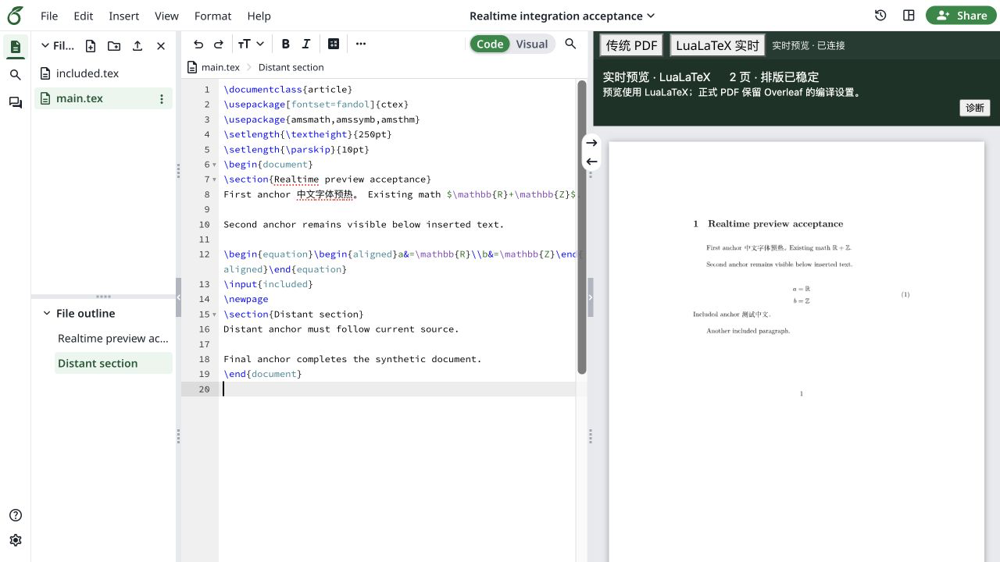

# Overleaf Realtime Preview

中文 / English — 中英文对照说明

我们想做的事情很简单：**在 Overleaf 里实现实时 LaTeX 预览，同时支持中文和英文。**

The goal is simple: **bring realtime LaTeX preview to Overleaf, with support for both Chinese and English.**

看到 [realtime-tex](https://github.com/HenryXiaoYang/realtime-tex) 开源后，我们觉得这件事有希望了。于是，我们主要借助 GPT（ChatGPT/Codex）编写和调试代码，尝试把它融合进 [Overleaf 的开源社区版](https://github.com/overleaf/overleaf)，让大家继续用熟悉的编辑器，在原来的右侧窗口里看到实时预览。

When [realtime-tex](https://github.com/HenryXiaoYang/realtime-tex) was released as open source, we saw a way to make this happen. We used GPT (ChatGPT/Codex) for most of the coding and debugging, working to integrate it into [Overleaf Community Edition](https://github.com/overleaf/overleaf). The idea was to keep the familiar editor and show the live preview in its existing right-hand pane.

## 从想法到现在 / How we got here

接起来之后，真正的麻烦才开始。尤其是在较大的中文项目里，出现了不少问题：新起一段要等很久，同一段里继续输入却很快；刚显示的文字又消失了；删掉的内容重新出现；公式还没写完，预览就卡住；跨页时更新慢，定位和行距也时常不对。

Getting the two projects connected was only the beginning. Larger Chinese documents exposed all sorts of bugs: a new paragraph could take ages to appear while edits within it felt quick; text would appear and then disappear; deleted content would return; unfinished formulas could stall the preview; and page breaks, position following and line spacing caused more trouble.

后面就是大量的使用、反馈和调试。我在实际写作中反复试，把遇到的问题反馈给 GPT，再一起排查、修改、验证。现在我们把一个基本可用的版本整理出来，希望更多人能试一试，告诉我们哪里好用、哪里还不行，也欢迎一起改进。它还不完善，尤其需要更多中文和英文项目的实际反馈。

What followed was a lot of use, feedback and debugging. I kept trying it in real writing, reporting what went wrong, and working with GPT to investigate, change the code and check the results. We are now sharing an initial usable version so more people can try it, tell us what works and what does not, and help improve it. There is still work to do, and feedback from more Chinese and English projects would be especially welcome.

## 感谢 / Thank you

**非常感谢 realtime-tex 项目组的杰出工作和贡献。没有他们的开源工作，就不会有这个尝试。** 也感谢 Overleaf 和 [realtime-tex-vsc-plugin](https://github.com/HenryXiaoYang/realtime-tex-vsc-plugin) 的作者与贡献者。本项目建立在这些开源项目之上，主要做集成和针对实际使用问题的修改；原作者的署名和许可均予以保留。

**Our deepest thanks to the realtime-tex team for their outstanding work and contributions. This project would not have been possible without their open-source work.** We also thank the authors and contributors of Overleaf and [realtime-tex-vsc-plugin](https://github.com/HenryXiaoYang/realtime-tex-vsc-plugin). This project builds on their work, focusing on integration and fixes prompted by actual use. Original credits and licenses are preserved.

*演示使用合成文档。 / The demo uses a synthetic document.*

## 反馈问题 / Reporting problems

如果你遇到卡顿、显示错误、内容消失，或者有其他建议，欢迎到 [GitHub Issues](https://github.com/WangMeng20152019/overleaf-realtime-preview/issues) 告诉我们。简单说清楚做了什么、预期怎样、实际发生了什么，最好再附一个能复现问题的小例子，就很有帮助。

If you run into slow updates, rendering errors, disappearing content, or have suggestions, please open a [GitHub issue](https://github.com/WangMeng20152019/overleaf-realtime-preview/issues). Tell us what you did, what you expected and what actually happened. A small example that reproduces the problem would be very helpful.

实时预览里提供了 **“诊断”按钮**，可以下载预览状态和耗时记录，方便排查问题。它不会自动提交报错。分享前请检查文件，去掉项目标识等不想公开的信息；也请不要上传私人论文、账号或访问令牌。

The live preview includes a **诊断 (Diagnostics) button** that downloads preview state and timing information to help with troubleshooting. It does not submit a report automatically. Review the file before sharing it and remove project identifiers or anything else you do not want to make public. Please do not upload private manuscripts, account details or access tokens.

## 使用与当前版本 / Getting started

当前版本为 **0.1.0-alpha.2**，是完整源码的实验性发布。支持在 Overleaf 原来的预览区切换传统 PDF 与 LuaLaTeX 实时预览。中文和英文预览是我们的目标，也已做过中文正文和公式测试；不同模板、字体、输入法和大型项目仍需要更多验证。

**0.1.0-alpha.2** is an experimental release of the complete source. It lets you switch between traditional PDF and LuaLaTeX realtime preview in Overleaf's existing preview pane. Chinese and English preview is the goal, and Chinese text and formulas have been tested. More testing is needed across templates, fonts, input methods and large projects.

请从[安装说明](docs/installation/README.md)开始，先用项目副本尝试。目前安装验证针对固定的 Overleaf CE 环境；实时预览使用 LuaLaTeX，正式 PDF 保留原来的编译设置。已知的定位、跨页和重新开启预览等限制，见[兼容说明](docs/COMPATIBILITY.md)。

Start with the [installation guide](docs/installation/README.md) and try a copy of your project first. Installation has been validated against a pinned Overleaf CE environment. Live preview uses LuaLaTeX; formal PDF compilation keeps your existing settings. See [compatibility notes](docs/COMPATIBILITY.md) for known limitations around navigation, pagination and reopening the preview.

- [下载安装包 / Downloads](https://github.com/WangMeng20152019/overleaf-realtime-preview/releases/tag/v0.1.0-alpha.2)
- [开发与 AI 使用说明 / Development and AI use](docs/DEVELOPMENT.md)
- [实际遇到的问题 / Bug history](docs/BUG_HISTORY.md)
- [本地调试网页 / Local debug page](dev/preview/README.md)
- [运行环境与测试 / Environment and tests](docs/ENVIRONMENT_AND_TESTS.md) · [验证记录 / Validation](docs/VALIDATION.md)

## 许可证 / License

本集成按 **AGPL-3.0-only** 发布。第三方组件保留各自的许可和署名，详见 [COPYING](COPYING)、[NOTICE](NOTICE) 和 [THIRD_PARTY.md](THIRD_PARTY.md)。

This integration is released under **AGPL-3.0-only**. Third-party components retain their own licenses and credits; see [COPYING](COPYING), [NOTICE](NOTICE) and [THIRD_PARTY.md](THIRD_PARTY.md).
