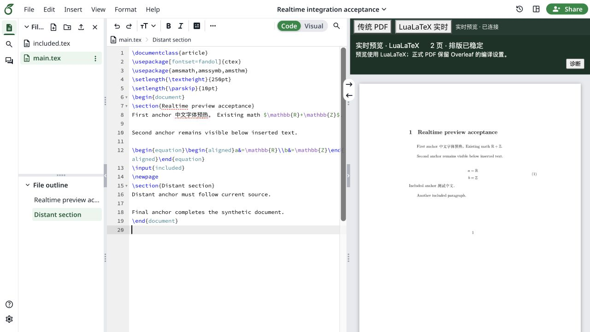

# Overleaf Realtime Preview

[English](README.en.md)

把 [realtime-tex](https://github.com/HenryXiaoYang/realtime-tex) 的增量排版接进自部署的 [Overleaf CE](https://github.com/overleaf/overleaf)，在原来的右侧预览区切换「传统 PDF」和「LuaLaTeX 实时预览」。

> **实验性源码版 · 0.1.0-alpha.2**  
> 提供源码和构建工具，已在固定环境验证安装、实时显示与合成编辑场景；当前支持范围和具体结果以[兼容范围](docs/COMPATIBILITY.md)和[验证记录](docs/VALIDATION.md)为准。

这个项目起于写中文论文时的一个想法：能不能继续用熟悉的 Overleaf 编辑器，又少等几次完整编译？于是从已有的开源引擎开始，把预览、编辑器事件和自部署环境接在一起。实际写作中出现的卡顿、公式输入、内容消失和删除后回退等问题，又不断推动后面的修改。现在把这部分集成工作整理出来，希望其他有相似需要的人也能尝试、复现和改进。

## 先感谢上游

这个项目建立在 **[realtime-tex](https://github.com/HenryXiaoYang/realtime-tex)、[Overleaf CE](https://github.com/overleaf/overleaf) 和 [realtime-tex-vsc-plugin](https://github.com/HenryXiaoYang/realtime-tex-vsc-plugin)** 的工作之上。它们提供核心排版引擎、编辑平台和浏览器渲染基础。本仓库的工作集中在集成、下游补丁、状态协调、导航、恢复与部署工具；原作者和贡献者的署名、许可均保留。

**大部分代码编写、修改、调试和测试构造借助 ChatGPT/Codex 完成。** 项目发起者提出需求，在真实中文写作中持续使用、反馈问题，并验证修改后的体验。开发过程是这样一轮轮推进的。测试结果和使用限制均单独记录。更多归属说明见[开发说明](docs/DEVELOPMENT.md)。



截图使用合成文档，不包含私人论文。

## 目前实现了什么

- 在 Overleaf 原有的右侧预览区切换传统 PDF 与实时模式。
- 已有段落的小幅修改优先走局部更新，后台继续完成整篇排版。
- 利用编辑器事件和源位置映射连接编辑位置、预览定位与导航。
- 为新段落、未完成公式、连续修改、删除和后台排版结果增加一致性与恢复检查。
- 提供固定上游版本的引擎构建、前端隔离构建、项目绑定、服务生命周期和代理回滚工具。

实时预览使用 **LuaLaTeX**；正式 PDF 继续采用 Overleaf 原有编译设置。XeLaTeX 模板需要检查字体和排版差异。复杂结构、跨页和全局依赖仍可能触发完整排版，响应时间也会受 TeX 环境和连接方式影响。这里不承诺固定毫秒数、任意模板或任意 Overleaf 版本的兼容性。

定位按引擎给出的排版单元工作。普通正文可以跟随；复杂跨页环境及部分包含文件的位置映射仍较粗或不完整，某些末尾位置也可能无法准确对应，不等同于逐字符 SyncTeX。需要精确定位时可切回传统 PDF。真实操作系统拼音输入法、更多模板和多人并发还需要继续验证。

首版请保持实时模式开启再编辑。若在传统模式、断开期间或其他会话中修改了正文，重新开启实时模式可能因快照不一致而暂停；需要管理员按[刷新快照步骤](docs/installation/README.md#refreshing-a-stale-preview)重新加载当前正文。这个版本尚未自动接管此类外部修改。

[运行环境与测试清单](docs/ENVIRONMENT_AND_TESTS.md) · [隐私与发布检查](docs/SECURITY_AND_PRIVACY.md)

## 从哪里开始

请先阅读[安装与验收步骤](docs/installation/README.md)，在独立测试实例里使用一个项目副本。首版面向 **Linux amd64、一个明确固定的 Overleaf CE 源码/镜像组合、一个绑定项目和一个控制编辑会话**。准确镜像摘要、所需 TeX 包、操作前提和未覆盖的场景均列在文档中。

新环境验证覆盖引擎构建、中文与四种公式恢复，以及真实 Overleaf 中的新段落、公式恢复、多段删除、跨文件修改和两种预览切换。历史私人服务器的结果另行标记；各项测试和生命周期验收的详情见验证记录。

源码包包含集成源码、引擎补丁、许可和构建工具；运行文件由你在本地生成。它不打包私人文档、开发缓存、引擎可执行文件或 TeX 字体。先检查源码构建：

```sh
npm ci --ignore-scripts
npm run build
npm test
npm run test:deployment
```

这组命令只负责本仓库的构建与测试。后续引擎构建、前端接入和服务安装按[安装文档](docs/installation/README.md)执行。[引擎说明](engine/README.md)还提供官方源码压缩包的校验下载方式，以及匹配的 TeX 支持文件和依赖许可收集流程。

## 反馈与参与

开发中最费时间的，往往是「已经能显示」之后的问题：第一段很慢，第二段很快，输入第三段时第二段却消失；公式还没打完就卡住；删掉的内容又回来了。这些经历整理在[问题记录](docs/BUG_HISTORY.md)里。

欢迎提交能用合成文档复现的问题，说明操作顺序、编译器/模板和最后观察到的状态。请先去掉私人论文、账户信息、访问令牌与原始诊断中的敏感内容。诊断记录中，真实观察到的结果比「应该已经修好」更有帮助。

想参与调试，可以从[合成文档预览页](dev/preview/README.md)开始。它连接实际编辑器事务、桥接和渲染代码，便于重复测试；完整 Overleaf 验收仍需在对应环境中单独完成。

[开发与归属](docs/DEVELOPMENT.md) · [验证记录](docs/VALIDATION.md) · [兼容范围](docs/COMPATIBILITY.md) · [变更记录](CHANGELOG.md) · [发布计划](docs/RELEASE_PLAN.md)

## 许可证

本集成按 **AGPL-3.0-only** 提供，全文见 [COPYING](COPYING)。第三方组件保留原许可与署名，来源见 [THIRD_PARTY.md](THIRD_PARTY.md)。首次公开范围是源码；如果重新分发编译后的运行包，需要同时保留构建工具生成的组件许可和 notices 清单。
